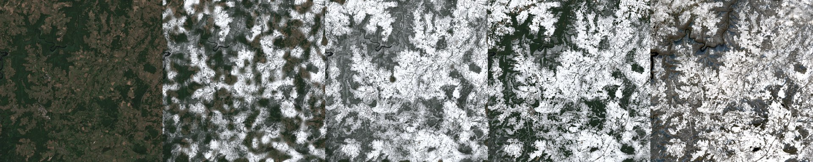

# jackfrost

Simulated snow cover for aerial and satellite imagery, calibrated against
real Sentinel-2 winter captures.



*A 15 km validation chip (MGRS 31TDL, 10 m/px). Left to right: the real
summer capture; snowified at s=0.5 and s=1.0 (synthetic patchy cover);
snowified with the cover forced to the real winter snow mask; the real
winter capture of the same tile. Only the rightmost panel is real winter.*

Snow is the extreme appearance shift for visual navigation: it erases the
field mosaic and most photometric texture, while dark linear features —
forest boundaries, hedgerows, streams, plowed roads — stay visible or grow
MORE salient. `snowify` reproduces that: it whitens open land toward a
calibrated snow luminance modulated by the terrain's own relief shading,
lets thin dark features survive via a morphological top-hat, keeps forests
and water dark with steep texture/luminance gates, and sweeps partial cover
(the `-s` knob) through a smooth noise field so patches keep sharp
boundaries. A sub-pixel blur on the coverage map stands in for the sensor
point-spread at snow edges.

## Calibration

Paired same-tile Sentinel-2 L2A captures (MGRS 31TDL/31TCL; summer
S2B_20250807 vs winter S2A_20240120, 36% snow): snow-covered land is ~9x
brighter than clear land and carries ~6x the gradient energy — snow is
bright relief crossed by a dark lattice, not a whiteout. The appearance
constants (`defaultParams`) are fitted, not hand-set: `-fit N` random-
searches them to match an 8-statistic vector (luminance and gradient
percentiles in and out of the real snow mask, white fraction) against the
real winter chips, with the snow cover forced to the real winter NDSI mask
so appearance is fitted decoupled from cover placement.

## Usage

    snowify                          # S2 self-validation chips + grades
    snowify -fit 600                 # refit appearance params, then render
    snowify -frames DIR -s 0.7      # snowify rendered frames (8-bit PNG)

Frame mode normalizes each frame's radiometry into the calibration space
for the gates (median luminance to the summer clear-land level) and blends
in the frame's own display space; `-gsd` rescales the physical-length
constants when the frame resolution differs from Sentinel-2's 10 m/px.
`frames_params.json` carries the domain overrides for rendered aerial
frames.

## Flight mode: snow and clouds on a simulated flight

Frame mode snowifies each picture on its own. On the frames of a flight
(one render per aircraft pose, 15 a second) that makes the snow patches
jump from frame to frame, and frames from a low aircraft range from 0.1 to
1 m/px. Flight mode ties the weather to the ground instead. With the poses,
the lens the frames were rendered through and a DEM, every pixel's ground
point is found by casting its ray onto the terrain, and:

- **snow** keeps the calibrated model but takes its scale from each frame's
  ground resolution and its partial-cover noise from a 10 m field on the
  ground, so a snow patch stays where it is; the snow degree rises with the
  ground height; open water stays open (`-water`), and the asphalt of
  plowed roads stays clear (`-roads`). Roads are plowed by chance, by class:
  motorways nearly always, main roads mostly, streets and service roads
  seldom (`-plow` changes the shares), decided along the network with a
  correlation length of a few kilometres (`-plow-km`), fixed for the flight;
- **clouds** are a 3-D layer of scattered cumulus between a base and a top
  above the smoothed terrain, drifting with the wind, ray-marched through
  the lens with sunlit domes, grey lee sides and shadows on the ground
  (sun position from the pose time). The aircraft flies through the layer
  when its path crosses it;
- **both** draws the cloud over the snow in one pass.

```
snowify -poses poses.json -calib lens.json -dem dem/ -frames clear/ -out winter/ \
        -weather snow -params params/winter_ortho.json -a-fixed -1 \
        -roads roads.geojson -water water.geojson -h-low 600 -h-high 800
snowify -poses poses.json -calib lens.json -dem dem/ -frames clear/ -out cloudy/ \
        -weather cloud -cloud-cover 0.375 -cloud-base 500 -cloud-top 800 -wind 2,-5
snowify ... -weather snow+cloud ...
```

`poses.json` is `{"poses": [...]}` with `lat_deg`, `lon_deg`, `alt_m_msl`,
`heading_deg`, optionally `body_roll_deg`, `body_pitch_deg`,
`body_yaw_deg`, and for clouds `t_s` and `time_utc`. The lens is a
Brown-Conrady calibration (see `snowify/lens.go`, `testdata/lens.json`),
the DEM a directory of GeoTIFF tiles in the poses' height datum.
`params/winter_ortho.json` is the open-plains fit with the gates set for
summer orthophotos. A rerun skips frames already written, so a stopped run
continues. The theory of operation is at the top of `snowify/flight.go`
and `snowify/clouds.go`.

## Landscape priors

Snow appearance is landscape-dependent: open plains bury the field
structure under smooth uniform white, bocage keeps a dark hedgerow
lattice, the high foreland pushes brightness further and turns the
lattice nearly off. Parameters fitted on one landscape do not transfer
(objective inflates ~30x), but per-landscape fits recover near-home
quality. `params/` holds the fitted sets — `bocage.json` (the built-in
default), `lowland.json`, `alpine.json` — for `-params`.

`pull` fetches a paired summer/winter capture of any region:

    pull -bbox "7.4,46.1,8.3,46.6" -out raw_alpine
    snowify -raw raw_alpine -summer <id> -winter <id> -autochips -fit 600

Raw S2 chips are pulled from the public earth-search STAC
(sentinel-cogs); GeoTIFF reading via github.com/lvdlvd/geotiff.
